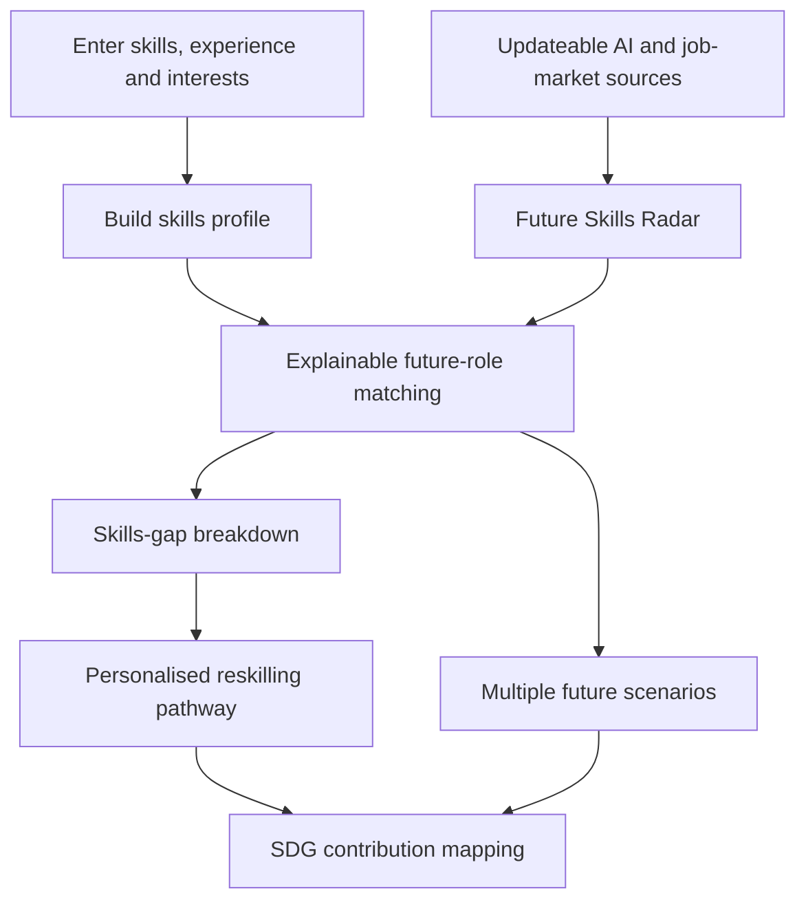

<div align="center">

# 🌅 TomorrowWorks

### Navigate the future of work, one skill at a time.

**An AI-powered, evidence-driven career navigation and reskilling platform for Malaysia's future-ready workforce.**


</div>

## Overview

AI is changing the skills employers need faster than many workers can adapt. **TomorrowWorks** aims to help working adults, graduates, career switchers, and career advisers understand which roles may be changing, identify transferable skills, and plan practical next steps.

Instead of offering generic chatbot career advice, TomorrowWorks is designed to connect **dated, identifiable labour-market and AI-trend signals** to **explainable role recommendations**, **personalised skills-gap analysis**, and **actionable reskilling pathways**. Recommendations also explain their relationship to the **17 United Nations Sustainable Development Goals (SDGs)**.

> **Project stage:** Planning and documentation. There is no runnable prototype in this repository yet. Features and architecture below describe the intended implementation.

## The Problem

- Workers may not know which AI-related skills to learn next.
- Graduates and career switchers struggle to identify resilient career pathways.
- Employers and educators need clearer evidence for reskilling decisions.
- Static career advice becomes outdated as AI capabilities and hiring needs evolve.

**Our question:** How can we turn changing AI and job-market signals into understandable, personalised, and human-centred career guidance?

## Who It Is For

- Working adults facing possible job displacement
- Fresh graduates and career switchers
- HR and learning-and-development teams
- TVET and university career centres

## Core User Journey



1. **Build a profile:** Enter skills, experience and interests using a form or questionnaire; CV upload is an optional intake method.
2. **Explore the Future Skills Radar:** See rising and declining skills and roles, with source names and dates.
3. **Find suitable roles:** Review ranked recommendations, understandable match scores, and missing skills.
4. **Follow a pathway:** Receive an ordered learning plan with estimated time and free or low-cost learning resources.
5. **Understand impact and uncertainty:** See relevant SDGs and compare more than one plausible AI-adoption scenario.

## Required Features

| Feature | Planned implementation | Acceptance check |
| --- | --- | --- |
| Skills profile intake | Form/questionnaire for skills, experience and interests | Sample user can create a profile |
| AI-trend signal layer | Ingest at least one updateable public AI/job-market data source | Display source and date; updated data can change output |
| Future-role matching | Rank roles using documented scoring logic | Each role has a score and an explainable skills gap |
| Personalised reskilling | Generate an ordered, time-estimated learning pathway | Link to verifiable free/low-cost resources |
| SDG mapping | Connect each recommended role and skill to at least one SDG | Explain why the SDG connection matters |
| Handling uncertainty | Compare at least two future scenarios | Clearly label forecasts as estimates, not certainties |

### Suggested differentiator: Future Signal Engine

**Evidence → Skill trend → Future role → Personal fit → Skill gap → Learning plan**

The key prototype goal is to show that **changing trend evidence changes a career recommendation or its explanation**. This distinguishes TomorrowWorks from a static list of jobs or a generic CV chatbot.

## Example Demo (Illustrative Only)

**Sample profile:** Junior Accountant; skills in Excel, bookkeeping and financial reporting; interested in analytics.

**Possible recommendation:** Financial Data Analyst.

**Existing skills:** Excel, financial reporting, domain knowledge.  
**Potential gaps:** SQL, Power BI, Python.  
**Example pathway:** SQL fundamentals → dashboarding → Python analytics → AI-assisted financial analysis.

> This is **synthetic demonstration content**, not a validated labour-market forecast. Do not display fabricated demand percentages, job statistics, course links, or match scores as real evidence.

## Data, Evidence and AI Guardrails

- Use **public, open or synthetic data only**; no real CVs or personal records in demos.
- Show the **name, date and link/reference** for each underlying trend source.
- Document the scoring methodology, assumptions and limitations.
- Verify job titles, courses, and statistics rather than allowing a language model to invent them.
- Disclose any language model actually used, including its purpose; **model selection is TBD**.
- Present AI forecasts as scenarios/estimates, not guaranteed outcomes.
- Support human career decisions; do not automate final hiring decisions.
- Avoid making recommendations based on protected or irrelevant personal attributes.
- Disclose development assistance from AI tools, including Codex, in the required Technical & Tools Declaration. The team must review and be able to explain all submitted work.

## Proposed Architecture

```text
TomorrowWorks/
├── frontend/               # Profile, radar, matching and pathway UI
├── backend/                # API and orchestration (if needed)
├── data/
│   ├── sample-profiles/    # Synthetic demo profiles
│   └── sources/            # Public datasets, metadata and citations
├── services/
│   ├── trend-signals/      # Source ingestion and trend extraction
│   ├── skill-matching/     # Explainable role ranking and gaps
│   ├── pathways/           # Learning-plan generation
│   └── sdg-mapping/        # SDG tags and explanations
├── docs/                   # Design, methodology, demo and sources
└── README.md
```

**Technology stack:** To be decided by the team. The hackathon brief allows free choice of stack. This folder structure is a proposal and should be updated to match the actual codebase.

## MVP Priorities

- [ ] Create a synthetic sample profile and a working intake form
- [ ] Connect one updateable trend source and display its date/citation
- [ ] Build a transparent skill-to-role matching function
- [ ] Show ranked roles and missing skills
- [ ] Demonstrate that updated trend data affects matching
- [ ] Generate a time-estimated learning pathway with verified resources
- [ ] Explain SDG links for each suggested role and skill
- [ ] Show moderate and rapid AI-change scenarios
- [ ] Prepare a reproducible live demo and document known limitations

## Running Locally

Setup commands will be added **once the technology stack and runnable code are in place**. Do not assume the project can be started from this README alone yet.

## Hackathon Submission Requirements

The **Domain 1: Aiversecity Future-Ready Workforce** brief requires a final product with all six features listed above. For the preliminary round, the proposal must explain how each will be delivered, and the demonstration must show a rough, working version of the most important feature. The trend signal layer feeding role matching is the suggested focus.

The **Participant Handbook** specifies six preliminary deliverables, due **25 October 2026 at 7:59:59 AM MYT (UTC+8)** through [sdchack.my](https://sdchack.my/):

1. Product Requirement Documentation using the official submission template, covering the problem, target users, scope, features and SDG alignment.
2. Pitch deck slides covering the problem, solution, technical approach and expected impact.
3. A working prototype link or accessible build with a functional interface. A video or static mockup alone does not satisfy this requirement.
4. Technical & Tools Declaration listing major APIs, cloud services, AI tools, datasets, models, sponsor resources and pre-existing materials.
5. An accessible GitHub repository and source-code link with a genuine, traceable development history.
6. A 5–7 minute pitching video with a prototype demonstration, submitted as a YouTube link.

The handbook also requires the submitted repository to be **public**, to contain an **Apache License 2.0 `LICENSE` file**, and to be accessible to judges. It says to keep the repository private during development and add the committee's designated GitHub account(s) as collaborators before submission. Check the official Discord for any later operational changes before changing repository visibility or sharing access.

**Required tools:** The Participant Handbook requires use of Replit and proof of that use in the Technical & Tools Declaration. Any work that needs a GPU must use RunPod; teams that use RunPod must include the specified dashboard screenshot or serverless endpoint evidence. Other tools remain available, subject to the declaration rules.

**Development record:** Build the project during the official competition period, commit actual progress as it happens, declare reused materials, and do not modify the submitted repository after the deadline unless the organisers instruct otherwise. Keep API keys, passwords and personal data out of the repository.

The preliminary rubric weights are **Innovation & Creativity (30%)**, **Problem–Solution Fit (25%)**, **Feasibility of Build (25%)**, and **Clarity of Proposal (20%)**. The final-round rubric is separate and will be shared with finalists.

## Scope

**In scope:** Career profiling, trend intelligence, matching, reskilling recommendations, SDG mapping and scenario comparison.

**Out of scope for this challenge:** Building full course content, payment systems and real recruitment integrations.

## Team

Team members and responsibilities: **TBD**.

## License

Licensed under the [Apache License, Version 2.0](LICENSE), as required by the Participant Handbook for the submitted repository. The project team retains ownership of its original work; third-party components retain their own licenses and must be attributed as applicable.

## Acknowledgements

Built for the **Aiversecity Future-Ready Workforce Domain (Domain 1)** hackathon challenge. Requirements and judging criteria are adapted from the event's *Domain 1 — Problem Statement & Marking Rubric* document.

---

<div align="center">

**TomorrowWorks — Discover what comes next. Build the skills to get there.**

</div>
