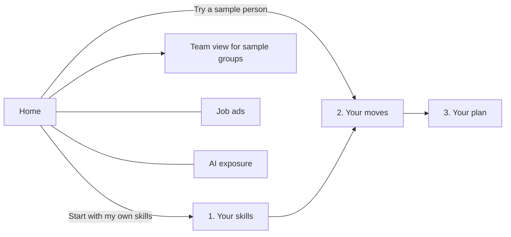

# TomorrowWorks

> From your CV to a career path for the AI era: a web app that shows a fresh graduate which skills a job ad asks for, whether their CV shows them, and what to learn next, using dated public labour-market and AI-exposure data.

---

## Team Information

| Field                  | Details                                     |
| ---------------------- | ------------------------------------------- |
| **Team Name**          | NoMoreTokens |
| **Team Domain**        | Domain 1: Aiversecity Future-Ready Workforce |
| **SDG Track (1–17)**   | SDG 4 (Quality Education, target 4.4) and SDG 8 (Decent Work and Economic Growth, targets 8.2 and 8.5) |
| **Team Leader**        | Lee Yun Loong |
| **University**         | Multimedia University (MMU) |
| **Number of Members**  | TO FILL |

## Links

| Resource          | Link                                           |
| ----------------- | ---------------------------------------------- |
| GitHub Repository | https://github.com/kairos8232/TomorrowWorks |
| Live Demo         | https://tomorrow-works.replit.app |
| RunPod Endpoint   | https://api.runpod.ai/v2/j6ssjfy9z074hp |
| Slide Deck        | TO FILL (PDF in [`submission/`](submission/)) |
| Demo Video        | TO FILL (YouTube) |

---

## Overview

### Problem

AI is changing tasks faster than career advice keeps up. In Malaysia, DOSM counted 555,509 online job offers in Q2 2026, and the ILO rates 112 of 427 occupations as exposed to generative AI. A fresh graduate holding a job ad cannot easily tell which skills it asks for, whether their CV shows them, or which role to aim for and what to learn first.

### Solution

TomorrowWorks turns a CV and a job ad into a clear gap list and a learning plan. An open embedding model (`BAAI/bge-m3` on RunPod) only maps text onto real ESCO skills, and the person confirms every skill. Roles are then ranked by a visible rule (skill fit, DOSM demand trend, ILO AI exposure), so changing the trend data visibly changes the result. AI never generates roles, courses or scores.

### Key Features

- **Your CV → a job ad → your plan** — paste a CV, paste an ad, see which of the ad's skills the CV shows, which are held but not shown, and which are still to learn, then get ordered, checked courses and a Malaysian NOSS/SKM route where one exists.
- **Check my CV** — plain, source-cited CV checks that need no job ad and run in the browser; nothing is stored.
- **Trend data feeds the ranking** — nine ESCO roles scored with visible skill fit, DOSM demand and ILO AI resilience; switch the DOSM quarter or the AI speed and the ranking changes; 1,000 seeded simulated futures show how stable the top choice is.
- **An updatable source** — DOSM Job Market Insights is quarterly; the server checks once a day for a newer quarter and one import command updates every score.
- **Team and Region views** — fictional groups for HR, career centres and regional skills centres, with SDG contribution shown in totals and no names.
- **Fairness and honesty** — a published fairness audit of the text intake, team-reviewed SDG links, and every signal shown with source, date and geography.

### Tech Stack

| Layer         | Technology                   |
| ------------- | ---------------------------- |
| Frontend      | React 19, TypeScript, Vite 6 |
| Backend       | Node 20 server with no dependencies (`server/index.mjs`) |
| Database      | None: nothing about a person is stored; public data ships as JSON files |
| AI / Compute  | RunPod: GPU Pod (Job A) and Serverless (Job B), `BAAI/bge-m3` |
| Hosting / Dev | Replit (Autoscale deployment) |

---

## Project Structure

```
.
├── data/                    # Dated source snapshots, derived data, SDG review
├── docs/                    # Product, scoring, screens and progress notes
├── runpod/                  # RunPod Job A script (embeds ESCO skills on a GPU Pod)
├── scripts/                 # Importers and audits (DOSM, ILO, ESCO, SDG, fairness)
├── server/                  # Node server: static site and API routes (+ tests)
├── src/                     # React app, scoring rule, CV checks, futures simulator (+ tests)
├── submission/              # Required submission documents (PDFs)
├── .env.example             # Environment variables to set
├── .replit                  # Replit run configuration
├── LICENSE                  # Apache 2.0
└── package.json
```

### Architecture

```
Browser (React) ──► Replit (Node server) ──► RunPod Serverless (bge-m3, Job B)
      │                    │
      │                    └──► ranks the ESCO skill vectors that Job A embedded once on a RunPod GPU Pod
      └──► scoring, CV checks and plan run in the browser on committed data snapshots
```

---

## How to Run

### Option 1: Run on Replit (recommended)

1. Open the Replit project, or import this repository with **Create Repl → Import from GitHub**.
2. Open the **Secrets** tab and add the variables listed in `.env.example`: `RUNPOD_API_KEY` and `RUNPOD_ENDPOINT_ID`.
3. Click **Run**. The app works without the keys, but the CV and skill search then falls back to a searchable list.

### Option 2: Run locally

```bash
git clone https://github.com/kairos8232/TomorrowWorks.git
cd TomorrowWorks
npm install
cp .env.example .env          # fill in your values (optional)
npm start                     # http://127.0.0.1:5173
# production build and server: npm run build && npm run serve   (port 5000)
```

### Run Tests

```bash
npm test
```

---

## How We Use Replit *(Required)*

- **Development and hosting:** the app is developed in Replit and published with Replit Deployments (Autoscale) at the Live Demo link above.
- **Secrets:** the RunPod API key and endpoint ID are stored in Replit Secrets and read by the server only. They are never in the code.
- **Why Autoscale:** the server holds the API key, so static hosting would not work.

📄 Proof of use: [`submission/SDC2026_NoMoreTokens_Replit_POU.pdf`](submission/SDC2026_NoMoreTokens_Replit_POU.pdf)

## How We Use RunPod *(Required)*

- **Job A (GPU Pod, run once):** `runpod/embed_esco_skills.py` embedded 13,960 ESCO v1.2.1 skills with `BAAI/bge-m3` on an NVIDIA RTX A5000 in 92.5 seconds. The vectors are saved in `data/derived/esco/`.
- **Job B (Serverless endpoint, live):** the Replit server sends a person's text to the endpoint, gets a query vector back, and ranks the closest real ESCO skills. The person then confirms which are true.
- **Integration:** the server reads `RUNPOD_API_KEY` and `RUNPOD_ENDPOINT_ID` from the environment.

Example request (an OpenAI-compatible embeddings route; use your own key and endpoint):

```bash
curl -X POST https://api.runpod.ai/v2/$RUNPOD_ENDPOINT_ID/openai/v1/embeddings \
  -H "Authorization: Bearer $RUNPOD_API_KEY" \
  -H "Content-Type: application/json" \
  -d '{"model": "BAAI/bge-m3", "input": ["maintain financial records"]}'
```

📄 Proof of use: [`submission/SDC2026_NoMoreTokens_Runpod_POU.pdf`](submission/SDC2026_NoMoreTokens_Runpod_POU.pdf)

---

## Challenges & Learnings

- **Public data is coarse:** DOSM gives demand by occupation group only, so roles in one group share a demand signal. We use quarter-on-quarter change and say so on screen.
- **AI needs checking:** AI matching alone proposed 73 SDG links and our two reviewers judged 21 relevant, so only team-reviewed links are used.
- **Bias in text matching:** our audit found ethnicity words pulled in language skills (63 suggestions across 12 descriptions, against 0 for neutral phrases). We strip common identity phrases first; this is reduced, not solved.
- **Cold starts:** the first RunPod search can be slow; a searchable list is the fallback.

## Future Improvements

- [ ] More roles that graduates apply for
- [ ] A finer Malaysian demand source and a quarterly DOSM import that a person approves
- [ ] Compare several job ads at once
- [ ] Interviews with real graduates, career centres and HR teams
- [ ] More hand-checked courses and reviewed Malay and Chinese skill names
- [ ] Optional accounts, with consent, to link a plan to a career centre or employer's Team view

## Team

| Name        | Role                | GitHub                                   |
| ----------- | ------------------- | ---------------------------------------- |
| Lee Yun Loong | Team Leader | [@kairos8232](https://github.com/kairos8232) |
| TO FILL | TO FILL | TO FILL |

---

## Submission Checklist

- [x] Team name, domain (Domain 1) and SDG track filled in
- [ ] Slide deck link added
- [ ] Demo video link added
- [ ] Replit used, with proof of use in `submission/`
- [ ] RunPod used, with proof of use in `submission/`
- [ ] Preliminary submission completed (`SDC2026_NoMoreTokens_Preliminary.pdf`)
- [ ] Technology declaration completed (`SDC2026_NoMoreTokens_TechDeclaration.pdf`)
- [ ] Submission files renamed with the team name
- [ ] "How to Run" steps verified
- [x] No API keys or secrets committed to the repository (scanned 24 Oct 2026)

This service uses the ESCO classification of the European Commission.

## License

This project is licensed under the [Apache License 2.0](LICENSE).

---

## Detailed Project Notes

### Overview

AI and other industry changes affect people across ages, occupations, and career stages. **TomorrowWorks** aims to help anyone explore what is happening at work, which skills and roles have supported demand signals, and what might change. The first source coverage is Malaysia-first; visitors can browse without an account.

Instead of offering generic chatbot career advice, TomorrowWorks is designed to connect **dated, identifiable labour-market and AI-trend signals** to **explainable role recommendations**, **personalised skills-gap analysis**, and **actionable reskilling pathways**. Recommendations also explain their relationship to the **17 United Nations Sustainable Development Goals (SDGs)**.

> **Project stage (24 Oct 2026):** a working React, TypeScript and Vite prototype runs on Replit with a RunPod-backed ESCO skill search. A fresh graduate follows *Your CV → A job ad → Your plan*; *Check my CV* works on its own; role rankings come from sourced DOSM and ILO data, with a daily DOSM new-quarter check. All people and teams are fictional. See [docs/SCREENS.md](docs/SCREENS.md), [docs/CHECKLIST.md](docs/CHECKLIST.md) and [docs/PROGRESS_LOG.md](docs/PROGRESS_LOG.md) for current behaviour and open items.

## The Problem

- Workers may not know which AI-related skills to learn next.
- Graduates and career switchers struggle to identify resilient career pathways.
- Employers and educators need clearer evidence for reskilling decisions.
- Static career advice becomes outdated as AI capabilities and hiring needs evolve.

**Our question:** How can we turn changing AI and job-market signals into understandable, personalised, and human-centred career guidance?

## Who It Is For

Anyone interested in work and skills, including students, employed or unemployed people, people returning to work, career switchers, advisers, and employers. The product does not ask for age to browse. Initial source coverage may be limited; the app must show those limits clearly. See [docs/PRODUCT_SCOPE.md](docs/PRODUCT_SCOPE.md) for the full product promise and evidence rules.

## How People Use the App



New visitors start on **Home** and can enter their own skills or use **View as** to explore fictional examples: Aina (working adult), Hakim (fresh graduate), Puan Rosnah (HR manager), Encik Lim (career adviser) and Encik Faizal (regional skills centre officer, Region view). Individuals follow **Your skills** (confirm ESCO skills from a RunPod search or the searchable list), **Your moves** (a compact ranking with visible personalisation controls and focused role, quarter-comparison and method views) and **Your plan** (ordered courses, uncovered gaps and NOSS/SKM routes). Role details keep skills and evidence links together; the method view holds the longer source and fairness explanations. Team view shows a manager's own group only (score heatmap, shared gaps); the Region view adds up the SDG contribution of all groups a regional skills centre funds, in totals with no names. Everyone can browse Job ads, AI exposure and the currently empty Workplace news page. The interface supports English, Bahasa Malaysia and Chinese; ESCO names and provider course titles remain in English. These are demo views, not accounts; no profile is saved. See [docs/SCREENS.md](docs/SCREENS.md).

## Required Features

| Feature | Working in the prototype | Remaining check |
| --- | --- | --- |
| Skills profile intake | Upload or paste a CV (read in the browser, contact details removed, lines matched to ESCO skills on RunPod, user ticks what is true), or confirm skills from RunPod-assisted ESCO search or the list, choose a current role and up to two optional work interests; fictional profiles can be loaded | Real accounts and saved CVs need separate privacy decisions |
| AI-trend signal layer | Dated DOSM Q1/Q2 2026 job-ad snapshots and ILO occupation exposure feed the role score; OpenDOSM monthly unemployment appears as separate context | Check DOSM reuse terms and refresh workflow before submission |
| Future-role matching | Nine ESCO roles ranked with visible skill fit, demand and AI-resilience parts; current job shown separately; exact, transferable and missing skills shown | Verify the complete live demo and source claims |
| Personalised reskilling | Selected move produces ordered steps from 21 checked course records, provider-stated times, uncovered gaps and a sourced NOSS/SKM route where found | Course coverage remains partial; a certification route is not a job requirement |
| SDG mapping | Role and skill links with reasons appear in moves, plans and team views; a person's chosen goals may optionally count in ranking | Team review of the drafted mappings is pending |
| Handling uncertainty | Q1/Q2 data switch and gradual/fast AI-change scenario switch show score and rank changes | Results are estimates based on stated weights, not forecasts of job loss |

### Suggested differentiator: Future Signal Engine

**Public market evidence → Current skills demand and future outlook → Personal fit → Skill gap → Learning plan**

The key prototype goal is to show that **changing trend evidence changes a career recommendation or its explanation**. This distinguishes TomorrowWorks from a static list of jobs or a generic CV chatbot.

## Chosen Signals and Matching (Preliminary Build)

Details, data shapes, findings and the worked example are in [docs/SIGNALS_AND_MATCHING.md](docs/SIGNALS_AND_MATCHING.md).

**Demo user:** a junior accounting assistant in the Klang Valley, 1–5 years in, whose routine tasks (data entry, billing, reconciliation, reports) are increasingly done by AI tools, deciding what to learn next. The clerical accounting work around this job (ISCO 4311) is in the ILO's highest GenAI-exposure gradient, while accountants are among DOSM's top advertised jobs.

### Data sources (all public, dated, attributed)

| Signal | Source | In the repo | Status |
| --- | --- | --- | --- |
| **Demand now** (the required updatable source) | DOSM *Big Data Analytics: Job Market Insights*, quarterly online job offerings by occupation major group | `data/sources/dosm-jmi-2026-q1.json`, `-q2.json` (`scripts/import_dosm_jmi.py`) | Imported; totals match DOSM's release (Q2 2026: 555,509) |
| **AI exposure** | ILO Working Paper 140, *Generative AI and Jobs: A Refined Global Index of Occupational Exposure* (2025), Table A1 | `data/sources/ilo-genai-exposure-2025.json` (`scripts/import_ilo_exposure.py`) | Imported; 427 occupations, 112 exposed, 13 in Gradient 4 (match the paper) |
| **Roles and skills** | ESCO v1.2.1 (European Commission) | `data/roles.json` (`scripts/build_roles.py`) | Built; 9 ESCO occupations with essential/optional skills and green/digital flags |
| **Skill search index** | ESCO v1.2.1 skills embedded with `BAAI/bge-m3` on a **RunPod GPU** | `data/derived/esco/` (`runpod/embed_esco_skills.py`) | Done: 13,960 skills in 92.5 s on an NVIDIA RTX A5000 |
| **Labour context** | OpenDOSM monthly Labour Force Survey | `data/sources/opendosm-lfs-month.json` (`scripts/import_lfs_month.py`) | Imported through Aug 2026; shown separately from job-ad scoring |
| **Workplace news** | GDELT metadata for Malaysian outlets | `data/sources/gdelt-news.json` (`scripts/import_gdelt_news.py`) | Page and importer built; no headlines imported yet; news never affects scores |

**Known limits:** DOSM's data file gives vacancies by major group only (not per job), so roles in one group share a demand signal; year-on-year DOSM changes are distorted by wider source coverage, so only quarter-on-quarter change is used. ILO exposure means tasks *could* change, not that jobs disappear.

### Role set

| Role (ESCO) | ISCO | ILO exposure | Essential skills |
| --- | --- | --- | --- |
| billing clerk | 4311 | 0.64 (Gradient 4) | 12 |
| **accounting assistant** (demo user's job) | 3313 | 0.49 (Gradient 2) | 20 |
| bookkeeper | 3313 | 0.49 (Gradient 2) | 18 |
| accountant | 2411 | 0.51 (Gradient 3) | 26 |
| financial analyst | 2413 | 0.62 (Gradient 4) | 23 |
| business analyst | 2421 | 0.46 (Gradient 2) | 26 |
| data analyst | 2511 | 0.49 (Gradient 2) | 36 |
| software developer | 2512 | 0.53 (Gradient 3) | 24 |
| sustainability manager | 1213 | 0.36 (Not exposed) | 48 |

### Scoring

The default score is `wF·F + wD·D + wR·R`, with every part shown on screen:

- **F, skill fit:** `(exact + 0.5 × transferable) / essential skills`. *Transferable* means the person holds a different ESCO skill whose RunPod embedding is ≥ 0.85 similar; the pair is shown. The person's current job is listed separately and only other roles are ranked.
- **D, demand trend:** `clamp(0.5 + quarter-on-quarter change, 0, 1)` for the role's DOSM major group.
- **R, AI resilience:** `1 − ILO mean exposure`.

| Scenario (estimate) | wF | wD | wR |
| --- | --- | --- | --- |
| Moderate AI change | 0.60 | 0.25 | 0.15 |
| Fast AI change | 0.50 | 0.20 | 0.30 |

Two **optional, off-by-default** switches can add work-interest fit and chosen-SDG fit to the ranking. Interest profiles use job tag for eight roles and O*NET for one; SDG links use documented role reasons and skill rules. Each optional part has weight 0.20 before all weights are rescaled. The user can inspect the resulting change in rank. See [docs/SIGNALS_AND_MATCHING.md](docs/SIGNALS_AND_MATCHING.md#interest-fit-optional-fourth-part-added-21-oct-2026) for the rules and source limits.

**Real result for the demo user (Q2 2026):** bookkeeper 58, accountant 45, billing clerk 36, financial analyst 21 under moderate change; under fast change sustainability manager rises from 6th to 4th. Details in [docs/SIGNALS_AND_MATCHING.md](docs/SIGNALS_AND_MATCHING.md#demo-result-with-real-data-accounting-assistants-20-esco-skills).

**Proof that trends matter:** a *Job-ad data* switch (DOSM Q1 ↔ Q2 2026) changes D for the same profile. Real example: Professionals +15.8% → −9.5% (D 0.66 → 0.41); Clerical support −1.8% → −17.2% (D 0.48 → 0.33). The importer can convert a future DOSM release; exposing a new snapshot in the current two-option interface also requires a small code update.

### Where AI is used: RunPod

RunPod is a required part of the build ([docs/RUNPOD_SETUP.md](docs/RUNPOD_SETUP.md)). One open-weights multilingual model, `BAAI/bge-m3`:

1. **Job A (GPU Pod, done):** embedded every ESCO skill once (Pod `40jrr8aulh76tb`, RTX A5000, 92.5 s).
2. **Job B (Serverless, live):** embeds the person's own description (English, Bahasa Malaysia or Chinese); the backend returns the nearest real ESCO skills and the person confirms which are true. A Chinese search was verified on the published Replit app on 21 Oct 2026; English and Malay live checks remain to be recorded.

The model only retrieves existing ESCO records. It never creates roles, courses, statistics or scores. If the endpoint is unavailable, the person picks skills from a searchable list.

## Example Demo (Synthetic Profile)

**Sample profile (fictional):** accounting assistant; confirms ESCO skills such as *accounting entries*, *maintain financial records*, *use accounting systems*, *issue sales invoices*; interested in analytics.

**How a match is explained:** for *data analyst*, the app lists which of its 36 ESCO essential skills the profile already holds and which are missing (for example *query languages*, *data visualisation software*, *perform data cleansing*), shows D from the DOSM Professionals group and R from ILO code 2511, and shows the scenario weights. The learning plan orders checked courses against the gaps, shows provider-stated time and leaves uncovered skills visible. A related NOSS/SKM route appears when sourced, without claiming it is required for employment.

> The profile is **synthetic**. Match scores are estimates calculated from the documented rule and sources; course links and study times come from checked provider pages. SDG links describe connections, not measured impact.

## Data, Evidence and AI Guardrails

Candidate news, vacancy, official-statistics, and skills sources are documented in [docs/API_PLAN.md](docs/API_PLAN.md). These sources must pass the Stage 1 access and suitability checks before the app presents their data.

- Use **public, open or synthetic data only**; no real CVs or personal records in demos.
- Show the **name, date and link/reference** for each underlying trend source.
- Document the scoring methodology, assumptions and limitations.
- Verify job titles, courses, and statistics rather than allowing a language model to invent them.
- Disclose `BAAI/bge-m3` and its retrieval-only purpose, plus the AI development tools actually used, in the Technical & Tools Declaration.
- Present AI forecasts as scenarios/estimates, not guaranteed outcomes.
- Support human career decisions; do not automate final hiring decisions.
- Avoid making recommendations based on protected or irrelevant personal attributes.
- Disclose development assistance from AI tools, including Codex, in the required Technical & Tools Declaration. The team must review and be able to explain all submitted work.

## Current App Structure

```text
TomorrowWorks/
├── index.html              # Browser entry point
├── src/
│   ├── main.tsx            # App shell, navigation and fictional View as options
│   ├── data.ts             # Source data and fictional people and teams
│   ├── SkillsStep.tsx      # 1. Your skills: RunPod search and skill list
│   ├── MovesStep.tsx       # 2. Your moves: ranked ledger and switches
│   ├── PlanStep.tsx        # 3. Your plan: courses, gaps and NOSS/SKM route
│   ├── TeamView.tsx        # Fictional team and class heatmaps
│   ├── PublicTables.tsx    # DOSM job ads and ILO exposure
│   ├── NewsView.tsx        # GDELT headlines or honest empty state
│   ├── i18n.tsx            # English, Bahasa Malaysia and Chinese interface text
│   ├── scoring.ts          # Explainable skill, demand and resilience score
│   ├── pathway.ts          # Course selection and order
│   ├── interests.ts, sdg.ts # Optional interest and SDG fit
│   └── styles.css          # Responsive styles
├── package.json            # Scripts and pinned dependencies
├── docs/CHECKLIST.md            # Staged build and submission tasks
├── docs/BUILD_STAGES.md         # Small commit slices for each stage
├── docs/SCREENS.md              # Purpose and behaviour of each screen
├── docs/PRODUCT_SCOPE.md        # Audience, public areas, and evidence rules
├── docs/PERSONAL_GUIDANCE.md    # Personal gaps, promotion targets, and credentials
├── docs/UI_UX.md                # Screen layout and usability decisions
├── docs/DESIGN.md               # Visual and component consistency rules
├── docs/RUNPOD_SETUP.md         # RunPod GPU jobs, evidence, and agent tooling status
├── runpod/
│   └── embed_esco_skills.py # RunPod GPU job: embed ESCO skills
├── docs/SIGNALS_AND_MATCHING.md # Chosen sources, scoring rule, and demo proof
├── CLAUDE.md               # Context and rules for coding agents
├── docs/PROGRESS_LOG.md         # What was done, findings, and open items
├── scripts/
│   ├── import_dosm_jmi.py      # DOSM xlsx → data/sources/dosm-jmi-<quarter>.json
│   ├── import_ilo_exposure.py  # ILO WP140 PDF → data/sources/ilo-genai-exposure-2025.json
│   ├── build_roles.py          # ESCO CSV → data/roles.json
│   ├── build_transferable_skills.py # RunPod vectors → transferable skills
│   ├── import_lfs_month.py     # OpenDOSM monthly labour context
│   ├── import_gdelt_news.py    # Malaysian workplace news metadata
│   ├── import_coursera_catalog.py, match_courses_runpod.py # Coursera courses matched to skills on RunPod
│   ├── match_sdg_runpod.py, calibrate_sdg_osdg.py # UN SDG targets matched to skills on RunPod; optional OSDG check
│   └── build_sdg_review.py, evaluate_sdg_review.py # Blind SDG review kit and keyword-baseline comparison
├── data/
│   ├── sources/            # Attributed DOSM, ILO, OpenDOSM and empty GDELT snapshots
│   ├── roles.json          # Nine ESCO roles with skills (adapted ESCO selection)
│   ├── derived/esco/       # ESCO skill vectors from the RunPod GPU run
│   ├── pathway/            # Checked courses and sourced NOSS/SKM routes
│   ├── interests/          # Role interest profiles and sources
│   ├── sdg/                # SDG goal names and the review of RunPod SDG matches
│   └── raw/                # Original downloads (gitignored)
├── .replit, replit.md      # Replit run workflow and notes
├── vite.config.ts          # Allows Replit's preview proxy; proxies /api in development
├── server/                 # Node server: built app + RunPod skill search (Job B)
├── skills/                 # Project-specific Codex UX skill
└── docs/API_PLAN.md             # Proposed sources and validation steps
```

**Current stack:** React, TypeScript and Vite on Replit, with a Node backend for skill search. RunPod is a required part of the build: a GPU Pod embedded the ESCO skill taxonomy with `BAAI/bge-m3`, and a Serverless endpoint serves query embeddings ([docs/RUNPOD_SETUP.md](docs/RUNPOD_SETUP.md)).

## Current Status and Next Work

- **Working (21 Oct):** fictional individual and team views ("View as"); ESCO skill intake with RunPod skill search, interests and SDG goals; nine-role ranking with DOSM Q1/Q2 and gradual/fast switches and "what changed"; learning plans (21 checked courses plus RunPod-matched Coursera suggestions, estimated time, HRD Corp note, NOSS/SKM step); Future Skills Radar; Team view with heatmap and group course plan; SDG links from RunPod matches with strong/possible levels and a 4.4 baseline; Workplace news (GDELT, refreshed daily until 1 Nov, key headlines picked by RunPod); English, Bahasa Malaysia and Chinese.
- **Review pending (team):** translations (`translation-review.csv`), SDG matches (blind review kit in `data/sdg/review/`, two reviewers), checked courses and NOSS codes, Coursera spot-check; DOSM reuse terms; live, mobile and link checks; Replit and RunPod evidence for the Tools Declaration. Optional: `scripts/calibrate_sdg_osdg.py` (OSDG) for goal-level accuracy.
- **Submission pending:** PRD in the official template, pitch slides, declaration, 5–7 minute video, public repository and judge access. Follow [docs/CHECKLIST.md](docs/CHECKLIST.md) for verified status and [docs/PROGRESS_LOG.md](docs/PROGRESS_LOG.md) for recent decisions.

## Running Locally

Use Node.js 20 or newer. From this repository:

```bash
npm ci
npm start
npm test       # scoring, pathway, interests, SDG, team, i18n and search checks
npm run build  # type-check and build dist/
npm run serve  # Node server on :5000, serving dist/ and /api/skill-search
```

For Vite development, run `npm start` and open [http://127.0.0.1:5173/](http://127.0.0.1:5173/). For the production-style server, run `npm run build` followed by `npm run serve` and open [http://127.0.0.1:5000/](http://127.0.0.1:5000/). Live skill search needs `RUNPOD_API_KEY` and `RUNPOD_ENDPOINT_ID` in the server environment; without them, visitors can still pick ESCO skills from the list. The demo keeps skills in the browser tab and does not offer accounts or résumé upload. NOSS/SKM entries show possible certification routes, not verified job requirements.

**On Replit:** the project is imported from branch `dev`; press **Pull** in Replit's Git tool, then **Run** (port 5000, see `replit.md`). Do not commit lockfile changes that point to Replit's internal package mirror.

**Rebuilding the data** (raw files go in `data/raw/`, which is gitignored; download links are in each JSON's `source` block):

```bash
pip install openpyxl                       # DOSM importer
brew install poppler                       # pdftotext, for the ILO importer (macOS)
python3 scripts/import_dosm_jmi.py data/raw/Data_JMI_Q2_2026.xlsx 2026-08-18 <download date>
python3 scripts/import_ilo_exposure.py "data/raw/Generative AI and Jobs: A Refined Global Index of Occupational Exposure.pdf" <download date>
python3 scripts/build_roles.py "data/raw/ESCO dataset - v1.2.1 - classification - en - csv"
python3 scripts/build_transferable_skills.py   # needs numpy; uses data/derived/esco/
python3 scripts/import_lfs_month.py            # OpenDOSM monthly labour force (internet; standard library)
python3 scripts/import_gdelt_news.py           # GDELT Malaysian workplace headlines (internet; standard library)
```

The ESCO embedding runs on a RunPod GPU Pod; see [docs/RUNPOD_SETUP.md](docs/RUNPOD_SETUP.md#part-2-project-gpu-work-required).

## UI design workflow

[docs/DESIGN.md](docs/DESIGN.md) records visual consistency rules; [docs/UI_UX.md](docs/UI_UX.md) records screen and usability decisions. The optional [Impeccable](https://impeccable.style/docs/) skill can be installed locally for Codex from this repository:

```bash
npx impeccable install -y --providers=codex --scope=project
```

The generated `.agents/skills/impeccable/` skill and `.codex/hooks.json` are local tooling, ignored by Git so design-tool downloads do not become a large project commit. Re-run the command on a new checkout before using the skill. Review its suggestions against Domain 1, the current product scope, and the source rules before editing the website.

## Hackathon Submission Requirements

The **Domain 1: Aiversecity Future-Ready Workforce** brief requires a final product with all six features listed above. For the preliminary round, the proposal must explain how each will be delivered, and the demonstration must show a rough, working version of the most important feature. The trend signal layer feeding role matching is the suggested focus.

The **Participant Handbook** specifies six preliminary deliverables, due **25 October 2026 at 7:59:59 AM MYT (UTC+8)** through [sdchack.my](https://sdchack.my/):

1. Product Requirement Documentation using the official submission template, covering the problem, target users, scope, features and SDG alignment.
2. Pitch deck slides covering the problem, solution, technical approach and expected impact.
3. A working prototype link or accessible build with a functional interface. A video or static mockup alone does not satisfy this requirement.
4. Technical & Tools Declaration listing major APIs, cloud services, AI tools, datasets, models, sponsor resources and pre-existing materials.
5. An accessible GitHub repository and source-code link with a genuine, traceable development history.
6. A 5–7 minute pitching video with a prototype demonstration, submitted as a YouTube link.

The handbook also requires the submitted repository to be **public**, to contain an **Apache License 2.0 `LICENSE` file**, and to be accessible to judges. It says to keep the repository private during development and add the committee's designated GitHub account(s) as collaborators before submission. Check the official Discord for any later operational changes before changing repository visibility or sharing access.

**Required tools:** The Participant Handbook requires use of Replit and proof of that use in the Technical & Tools Declaration. Any work that needs a GPU must use RunPod; teams that use RunPod must include the specified dashboard screenshot or serverless endpoint evidence. Other tools remain available, subject to the declaration rules.

**Development record:** Build the project during the official competition period, commit actual progress as it happens, declare reused materials, and do not modify the submitted repository after the deadline unless the organisers instruct otherwise. Keep API keys, passwords and personal data out of the repository.

The preliminary rubric weights are **Innovation & Creativity (30%)**, **Problem–Solution Fit (25%)**, **Feasibility of Build (25%)**, and **Clarity of Proposal (20%)**. The final-round rubric is separate and will be shared with finalists.

## Scope

**In scope:** Career profiling, trend intelligence, matching, reskilling recommendations, SDG mapping and scenario comparison.

**Out of scope for this challenge:** Building full course content, payment systems and real recruitment integrations.

## Acknowledgements

**This publication uses the ESCO classification of the European Commission.** `data/roles.json` is an adapted selection of ESCO v1.2.1; the Commission does not guarantee ESCO's accuracy or completeness.

Data source: Department of Statistics Malaysia. Data sources: Department of Statistics Malaysia (DOSM), *Big Data Analytics: Job Market Insights*, Q1 and Q2 2026; International Labour Organization, Working Paper 140, *Generative AI and Jobs: A Refined Global Index of Occupational Exposure* (2025); European Commission, ESCO v1.2.1. Model: `BAAI/bge-m3` (open weights), run on RunPod.


Built for the **Aiversecity Future-Ready Workforce Domain (Domain 1)** hackathon challenge. Requirements and judging criteria are adapted from the event's *Domain 1 — Problem Statement & Marking Rubric* document.

---

<div align="center">

**TomorrowWorks — Discover what comes next. Build the skills to get there.**

</div>
