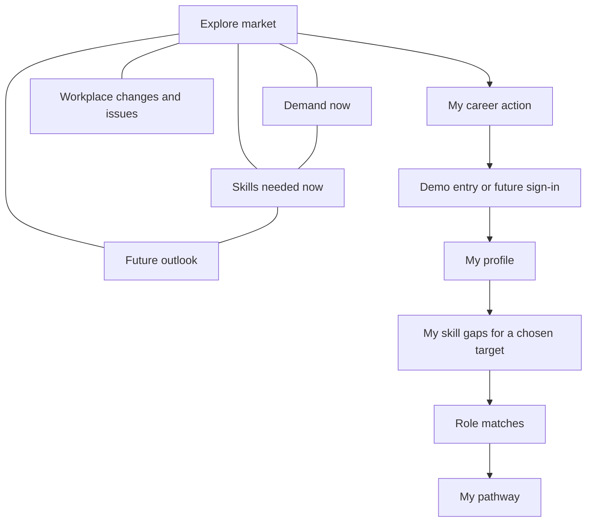

<div align="center">

# 🌅 TomorrowWorks

### Navigate the future of work, one skill at a time.

**A public, evidence-driven guide to changing work and skills, with optional personal career guidance.**


</div>

## Overview

AI and other industry changes affect people across ages, occupations, and career stages. **TomorrowWorks** aims to help anyone explore what is happening at work, which skills and roles have supported demand signals, and what might change. The first source coverage is Malaysia-first; visitors can browse without an account.

Instead of offering generic chatbot career advice, TomorrowWorks is designed to connect **dated, identifiable labour-market and AI-trend signals** to **explainable role recommendations**, **personalised skills-gap analysis**, and **actionable reskilling pathways**. Recommendations also explain their relationship to the **17 United Nations Sustainable Development Goals (SDGs)**.

> **Project stage:** The React and TypeScript app has cross-industry public browsing, honest no-source states, synthetic profile intake, and an illustrative personal skill-gap comparison. Sourced role matching, verified certificate requirements, pathways, news and market feeds, sign-in, and external integrations are still being built.

## The Problem

- Workers may not know which AI-related skills to learn next.
- Graduates and career switchers struggle to identify resilient career pathways.
- Employers and educators need clearer evidence for reskilling decisions.
- Static career advice becomes outdated as AI capabilities and hiring needs evolve.

**Our question:** How can we turn changing AI and job-market signals into understandable, personalised, and human-centred career guidance?

## Who It Is For

Anyone interested in work and skills, including students, employed or unemployed people, people returning to work, career switchers, advisers, and employers. The product does not ask for age to browse. Initial source coverage may be limited; the app must show those limits clearly. See [PRODUCT_SCOPE.md](PRODUCT_SCOPE.md) for the full product promise and evidence rules.

## How People Use the App



The public area has independent Explore, Workplace changes, Demand, Skills, and Outlook views, plus industry and search controls. Visitors can move among them freely and see the distinction between reported issues, present-day measures, and future estimates. **My career** is a separate action for personal guidance: review the person's skills and qualifications, compare them with an explicit promotion or career-move target, then explore role matches and a pathway as those Domain 1 features are built. The first demo uses a fictional profile and labels sign-in as planned; résumé upload is a later optional method. [PERSONAL_GUIDANCE.md](PERSONAL_GUIDANCE.md) defines the personal flow and evidence boundary.

## Required Features

| Feature | Planned implementation | Acceptance check |
| --- | --- | --- |
| Skills profile intake | Form/questionnaire for skills, experience, interests, optional qualifications, and work preferences after the sign-in entry | Sample user can review a fictional profile; real sign-in and résumé upload remain planned |
| AI-trend signal layer | Ingest at least one updateable public AI/job-market data source | Display source and date; updated data can change output |
| Future-role matching | Rank sourced roles using documented scoring logic; let a person inspect the gap for a chosen promotion or career move | Each role has an explainable skills gap and any certificate requirement is verified or marked unknown |
| Personalised reskilling | Generate an ordered, time-estimated learning pathway | Link to verifiable free/low-cost resources |
| SDG mapping | Connect each recommended role and skill to at least one SDG | Explain why the SDG connection matters |
| Handling uncertainty | Compare at least two future scenarios | Clearly label forecasts as estimates, not certainties |

### Suggested differentiator: Future Signal Engine

**Public market evidence → Current skills demand and future outlook → Personal fit → Skill gap → Learning plan**

The key prototype goal is to show that **changing trend evidence changes a career recommendation or its explanation**. This distinguishes TomorrowWorks from a static list of jobs or a generic CV chatbot.

## Example Demo (Illustrative Only)

**Sample profile:** Junior Accountant; skills in Excel, bookkeeping and financial reporting; interested in analytics.

This is one synthetic test case for matching. The public product is intended for people in any career stage and industry.

**Possible recommendation:** Financial Data Analyst.

**Existing skills:** Excel, financial reporting, domain knowledge.  
**Potential gaps:** SQL, Power BI, Python.  
**Example pathway:** SQL fundamentals → dashboarding → Python analytics → AI-assisted financial analysis.

> This is **synthetic demonstration content**, not a validated labour-market forecast. Do not display fabricated demand percentages, job statistics, course links, or match scores as real evidence.

## Data, Evidence and AI Guardrails

Candidate news, vacancy, official-statistics, and skills sources are documented in [API_PLAN.md](API_PLAN.md). These sources must pass the Stage 1 access and suitability checks before the app presents their data.

- Use **public, open or synthetic data only**; no real CVs or personal records in demos.
- Show the **name, date and link/reference** for each underlying trend source.
- Document the scoring methodology, assumptions and limitations.
- Verify job titles, courses, and statistics rather than allowing a language model to invent them.
- Disclose any language model actually used, including its purpose; **model selection is TBD**.
- Present AI forecasts as scenarios/estimates, not guaranteed outcomes.
- Support human career decisions; do not automate final hiring decisions.
- Avoid making recommendations based on protected or irrelevant personal attributes.
- Disclose development assistance from AI tools, including Codex, in the required Technical & Tools Declaration. The team must review and be able to explain all submitted work.

## Current App Structure

```text
TomorrowWorks/
├── index.html              # Browser entry point
├── src/
│   ├── main.tsx            # Public and personal navigation and app shell
│   ├── market.ts           # Industry and sourced-evidence contract
│   ├── personal.ts         # Illustrative target and exact skill comparison
│   └── styles.css          # Responsive styles
├── package.json            # Scripts and pinned dependencies
├── CHECKLIST.md            # Staged build and submission tasks
├── BUILD_STAGES.md         # Small commit slices for each stage
├── SCREENS.md              # Purpose and behaviour of each screen
├── PRODUCT_SCOPE.md        # Audience, public areas, and evidence rules
├── PERSONAL_GUIDANCE.md    # Personal gaps, promotion targets, and credentials
├── UI_UX.md                # Screen layout and usability decisions
├── skills/                 # Project-specific Codex UX skill
└── API_PLAN.md             # Proposed sources and validation steps
```

**Current stack:** React, TypeScript and Vite. Replit hosting and RunPod GPU integration remain separate build stages.

## MVP Priorities

- [x] Create a synthetic sample profile and a working intake form
- [x] Open on a public market view with an honest demo sign-in entry
- [x] Replace the numbered journey with freely browsable market destinations
- [x] Add public industry and search controls and a workplace-changes view
- [x] Add an illustrative personal skill-gap comparison for a chosen target
- [ ] Connect one updateable trend source and display its date/citation
- [ ] Build a transparent skill-to-role matching function
- [ ] Show ranked roles and missing skills
- [ ] Demonstrate that updated trend data affects matching
- [ ] Generate a time-estimated learning pathway with verified resources
- [ ] Explain SDG links for each suggested role and skill
- [ ] Show moderate and rapid AI-change scenarios
- [ ] Prepare a reproducible live demo and document known limitations

## Running Locally

Use Node.js 20 or newer. From this repository:

```bash
npm install
npm start
```

Open [http://127.0.0.1:5173/](http://127.0.0.1:5173/) after the server starts. `npm run dev` works too. To check a production build, run `npm run build`. The app accepts a synthetic profile and compares its listed skills with an editable illustrative target. It does not yet make sourced career recommendations or verify certificate requirements.

## UI design workflow

[UI_UX.md](UI_UX.md) records screen and usability decisions. The optional [Impeccable](https://impeccable.style/docs/) skill can be installed locally for Codex from this repository:

```bash
npx impeccable install -y --providers=codex --scope=project
```

The generated `.agents/skills/impeccable/` skill and `.codex/hooks.json` are local tooling, ignored by Git so design-tool downloads do not become a large project commit. Re-run the command on a new checkout before using the skill. Review its suggestions against Domain 1, the current product scope, and the source rules before editing the website.

## Hackathon Submission Requirements

The **Domain 1: Aiversecity Future-Ready Workforce** brief requires a final product with all six features listed above. For the preliminary round, the proposal must explain how each will be delivered, and the demonstration must show a rough, working version of the most important feature. The trend signal layer feeding role matching is the suggested focus.

The **Participant Handbook** specifies six preliminary deliverables, due **25 October 2026 at 7:59:59 AM MYT (UTC+8)** through [sdchack.my](https://sdchack.my/):

1. Product Requirement Documentation using the official submission template, covering the problem, target users, scope, features and SDG alignment.
2. Pitch deck slides covering the problem, solution, technical approach and expected impact.
3. A working prototype link or accessible build with a functional interface. A video or static mockup alone does not satisfy this requirement.
4. Technical & Tools Declaration listing major APIs, cloud services, AI tools, datasets, models, sponsor resources and pre-existing materials.
5. An accessible GitHub repository and source-code link with a genuine, traceable development history.
6. A 5–7 minute pitching video with a prototype demonstration, submitted as a YouTube link.

The handbook also requires the submitted repository to be **public**, to contain an **Apache License 2.0 `LICENSE` file**, and to be accessible to judges. It says to keep the repository private during development and add the committee's designated GitHub account(s) as collaborators before submission. Check the official Discord for any later operational changes before changing repository visibility or sharing access.

**Required tools:** The Participant Handbook requires use of Replit and proof of that use in the Technical & Tools Declaration. Any work that needs a GPU must use RunPod; teams that use RunPod must include the specified dashboard screenshot or serverless endpoint evidence. Other tools remain available, subject to the declaration rules.

**Development record:** Build the project during the official competition period, commit actual progress as it happens, declare reused materials, and do not modify the submitted repository after the deadline unless the organisers instruct otherwise. Keep API keys, passwords and personal data out of the repository.

The preliminary rubric weights are **Innovation & Creativity (30%)**, **Problem–Solution Fit (25%)**, **Feasibility of Build (25%)**, and **Clarity of Proposal (20%)**. The final-round rubric is separate and will be shared with finalists.

## Scope

**In scope:** Career profiling, trend intelligence, matching, reskilling recommendations, SDG mapping and scenario comparison.

**Out of scope for this challenge:** Building full course content, payment systems and real recruitment integrations.

## Team

Team members and responsibilities: **TBD**.

## License

Licensed under the [Apache License, Version 2.0](LICENSE), as required by the Participant Handbook for the submitted repository. The project team retains ownership of its original work; third-party components retain their own licenses and must be attributed as applicable.

## Acknowledgements

Built for the **Aiversecity Future-Ready Workforce Domain (Domain 1)** hackathon challenge. Requirements and judging criteria are adapted from the event's *Domain 1 — Problem Statement & Marking Rubric* document.

---

<div align="center">

**TomorrowWorks — Discover what comes next. Build the skills to get there.**

</div>
